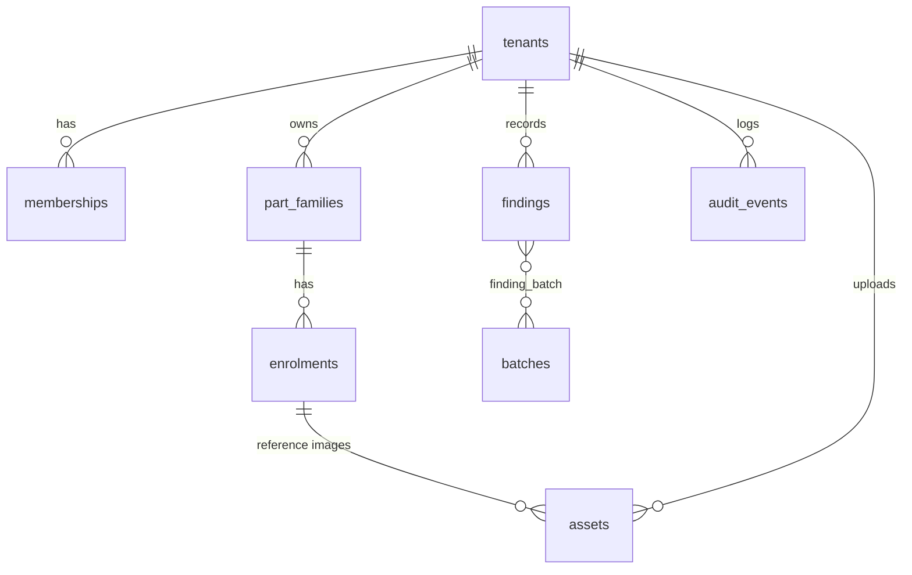
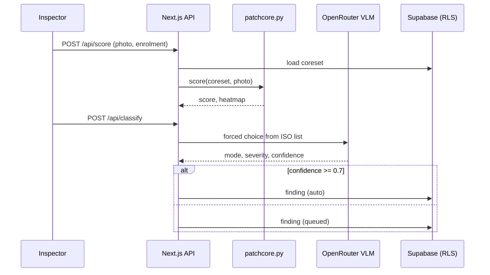

# Witness audit, 2026-09-27

> **Status, same day (branch `fix/audit-2026-09`).** Fixed in code: all of
> section 2 except 2.7 (a Vercel setting), S1 to S9, all of section 4 except
> observability and Playwright, section 5 except the specimen photo, section 6
> except screenshots, and from 7/8: CSV export, queue priority, mobile camera
> capture, heatmap overlay, model-against-inspector agreement. Needs an owner
> action: apply `supabase/migrations/20260927120000_*.sql`, set
> `PATCHCORE_TOKEN` in Vercel, restore the paused Supabase project, pull the
> baseline schema, clear the Vercel `noindex`. Not started: cases/RMA, roles,
> server PDF, alerts, seeded demo tenant, per-mode gates, anonymous-tenant
> cleanup (S10), direct-to-storage upload.

Scope: full read of `src/`, `api/`, `scripts/`, CI, README; `next build`, `eslint`,
`tsc`, `npm audit`, `npm outdated`; header and markup checks against the live site
(witness-kandula.vercel.app). Contrast ratios below were computed from the token
hex values in `src/app/globals.css`, not estimated.

Baseline: build, lint and typecheck all pass. The architecture is sound (RLS
multi-tenancy, stateless compute function, forced-choice classifier, token-driven
design system). The gaps are in data integrity, abuse protection, accessibility
claims, and the console experience. Several things the README and landing page
promise are not true in the production code path.

---

## 1. Scorecard

Subjective, 1 to 5, "production-grade" = 5.

| Area | Score | One-line reason |
|------|:----:|------|
| Architecture | 4 | Clean split, RLS, stateless ML function. Two parallel data paths (PGlite + Supabase) have diverged. |
| Data integrity | 2 | Review overwrites the model suggestion; originals never stored; no audit trail written. |
| Security / abuse | 2 | Public unauthenticated compute endpoint; no rate limits on a paid VLM; no upload caps; no security headers. |
| Reliability / ops | 2 | No error/loading/not-found boundaries, no timeouts, no monitoring, schema not in repo. |
| Accessibility | 3 | Good intent (glyph + hue, focus ring, skip link) but 10 primary buttons and most console meta text fail AA. |
| Visual design (marketing) | 4 | Distinct identity. Monotone card rhythm, no real product imagery, false hover affordances. |
| Console UX | 2 | Not responsive, no active nav, raw codes in tables, no pending/success feedback on review. |
| Docs / README | 4 | Strong figures and honesty section. Missing setup for Supabase, screenshots, data model, API examples. |
| Tests | 1 | One smoke test covering only the PGlite demo path. |
| SEO / discovery | 2 | Solid metadata work, but every live response carries `x-robots-tag: noindex`. |

---

## 2. P0: bugs and broken promises (fix first)

### 2.1 The model suggestion is destroyed on review (production path)
- `src/app/(console)/console/review/page.tsx:36-59` `saveReview` runs
  `update({ iso_mode, severity, ... })` on the same `findings` row the model wrote.
  The original suggestion is gone after a correction.
- README "Design invariants" says *"The model never overwrites the human call...
  keeps the suggestion immutable"* and the landing page says *"Every confirmation
  becomes training data."* Only the PGlite demo path (`review_mode_code` columns in
  `src/lib/db.ts`) keeps the pair. The Supabase path has no labels export at all.
- `audit_events` table exists in the schema but nothing writes to it.
- Fix: add immutable `model_mode`, `model_severity`, `model_confidence` columns (set
  once at classify, never updated) or a `finding_reviews` table; write an
  `audit_events` row per review; add `/api/export/labels` for Supabase.

### 2.2 A hallucinated VLM code silently auto-files as mode #1
- `src/lib/stage2.ts:95` `?? modes[0]` keeps the model's own confidence. A VLM that
  returns an off-list code at 0.9 auto-files as the first catalogue mode, skipping
  review. README claims the invented code is "discarded".
- Fix: on fallback set `confidence = 0` so the gate routes it to the queue, and
  note the discard in `rationale`.

### 2.3 Primary buttons are unreadable (rebrand leftover)
`bg-c-focus ... text-paper` puts dark ink (#1d1b17) on teal (#0e6e78): **2.88:1**,
fails AA. White on teal is 5.97:1. Replace `text-paper` with `text-on-accent` at:

`src/components/intake-form.tsx:72`, `review-form.tsx:84`, `ingest-form.tsx:73`,
`batch-form.tsx:113`, `subject-scorer.tsx:104`,
`src/app/(console)/console/review/page.tsx:206`, `batches/page.tsx:121`,
`enrol/page.tsx:135`, `enrol/page.tsx:218`.

### 2.4 Contradicting numbers and stale copy
| Where | Says | Truth |
|------|------|------|
| `src/app/page.tsx:195` hero gauge | gate threshold **0.82** | `CONFIDENCE_GATE = 0.7` everywhere else |
| `src/app/(console)/layout.tsx:71` rail footer | "Local-first · records never leave this workstation" | Live deploy stores everything in Supabase |
| `src/app/(console)/console/page.tsx:303` | "Ingest arrives in phase 2" | Phase 2 shipped |
| README badge | "WCAG 2.2 AA" | See section 5.3, several pairs fail |
| `src/app/login/page.tsx` error text | shown in `text-oxide` (brand teal) | Errors should use `sev-3` |

### 2.5 Evidence is not kept
`src/app/api/ingest/route.ts:77` `storage_uri: "inline"`, only a 240 px JPEG thumb is
saved. `crop_uri` is also a data URI. For a product whose pitch is "survives a
warranty dispute", the original photo, its SHA-256 and its EXIF must be stored.
Fix: private Supabase Storage bucket, signed URLs, hash on ingest.

### 2.6 The database schema is not in the repo
No `supabase/` folder, no `.sql`. Tables, RLS policies and `bootstrap_tenant` exist
only in the hosted project. Nobody (including you on a new machine) can rebuild the
backend. Fix: `supabase db pull` into `supabase/migrations/`, commit, and document.

### 2.7 Live site is de-indexed
Every live response (including `/robots.txt`) returns `x-robots-tag: noindex`. It is
not set by the app (no header config in the repo), so it comes from Vercel. Check
the project's domain / Deployment Protection / "Search engine indexing" setting,
or move to a custom domain. Until then the SEO and GEO work has no effect.

---

## 3. Security and abuse

| # | Issue | Where | Fix |
|---|------|------|------|
| S1 | `/api/patchcore` is public, unauthenticated, uncapped CPU work | `api/patchcore.py` | Shared-secret header (`PATCHCORE_TOKEN` env) checked by the function; reject bodies over N images |
| S2 | Anonymous sign-in + `/api/classify` = anyone can spend your OpenRouter credits | `src/app/api/classify/route.ts` | Per-tenant daily quota (count findings today), Vercel WAF rate-limit rule on `/api/*`, cap OpenRouter spend in its dashboard |
| S3 | No upload size or type limit on any upload route; `sharp` will decode a huge image | ingest, records, score, classify | Reject > 10 MB, check magic bytes, `sharp({ limitInputPixels })` |
| S4 | PGlite routes stay live and unauthenticated in the Supabase deploy | `api/records`, `api/batches`, `api/records/[id]/review`, `api/export/labels` | Return 404 when `supabaseConfigured` |
| S5 | Server action trusts form input | `review/page.tsx:36` | Validate mode against `modesFor(family)`, severity 0..4 integer, attribution in `ATTRIBUTIONS`; check the update error |
| S6 | No fetch timeouts | `stage2.ts` OpenRouter, `patchcore.ts` | `signal: AbortSignal.timeout(20_000)` |
| S7 | Function URL built from the request `Host` header | `src/lib/patchcore.ts:28` | Use `VERCEL_URL` / a configured origin |
| S8 | No CSP, `frame-ancestors`, `Referrer-Policy`, `Permissions-Policy` | `next.config.ts` | `headers()` block; CSP guide is in `node_modules/next/dist/docs/01-app/02-guides/content-security-policy.md` |
| S9 | `adm-zip` high-severity advisory (transitive) | `npm audit` | `npm audit fix` |
| S10 | Each anonymous visit mints a tenant that is never cleaned up | `src/lib/tenant.ts` | Nightly cron deleting anonymous tenants older than 7 days |

---

## 4. Production readiness

- **Next 16 convention**: build warns `The "middleware" file convention is deprecated. Please use "proxy" instead.` Rename `src/middleware.ts` to `src/proxy.ts` (docs: `node_modules/next/dist/docs/01-app/01-getting-started/16-proxy.md`). Narrow the matcher to `/console/:path*`, `/login`, `/report/:path*`; today it calls `supabase.auth.getUser()` (a network round trip) on every marketing page view.
- **No route boundaries**: zero `error.tsx`, `global-error.tsx`, `not-found.tsx`, `loading.tsx`. A Supabase hiccup shows the default error page; slow queries show nothing.
- **Truncated maths**: console stats come from `.limit(100)`, insights from `.limit(2000)`, export `.limit(1000)`. Past those counts the numbers are silently wrong. Move aggregates into SQL (views or rpc with `count`), paginate tables.
- **Dates render in the server's timezone**: `toLocaleString()` in 9 server components (UTC on Vercel). Use `Intl.DateTimeFormat` with the user's zone on the client, or ISO + relative time.
- **Observability**: no error tracking, no structured logs, no product analytics. Add Sentry (or Vercel's built-in), log every classify with model, latency, confidence, routed.
- **Tests**: `scripts/smoke.mjs` exercises only the PGlite demo. Nothing covers the path real users hit. Minimum set: unit tests for `iso.ts`, `buckets.ts`, `provenance.ts`, `phash.ts`, the stage-2 JSON parser; one Playwright run against a Supabase branch (sign in, enrol, score, classify, review, export); axe accessibility check in CI.
- **Two data paths**: PGlite `records` and Supabase `findings` are different schemas with different features (labels export exists only on one, review queue only on the other). Pick one: either delete the PGlite path, or make it run the same schema as an offline mode.
- **Dependencies**: `next` 16.3.6, `@supabase/ssr` 0.12 (5 minors behind), `zod` 4.6 available.

---

## 5. Design

### 5.1 Layout and composition

Marketing (`src/app/page.tsx`):
- Seven sections, almost all the same unit: bordered card, mono kicker, display title, grey body. The rhythm goes flat by section three. Break it with one full-bleed section and one asymmetric one.
- **No photograph of real damage anywhere.** This is a vision product. The strongest missing piece is a "specimen" section: a spalled raceway photo, the heatmap overlaid on it, and the resulting finding card beside it (mode, clause, severity chip, batch link). That one image explains the product faster than the five-step list.
- The SpecPlate block (fastener torque, spring rate, flange) is decoration unrelated to what Witness does. Cut it, or turn the plates into the four fields a finding actually records.
- Hero CTA "Open the console" lands on `/login` in production. Label it "Try the demo workspace" and sign in anonymously in one click.
- `/login` has no header, footer or back link: a dead end. Wrap it in `PublicShell`.
- Home page has no skip link and `<main>` has no `id="main"`; only `PublicShell` pages do.

Console (`src/app/(console)/layout.tsx`):
- Rail is a fixed 280 px with no breakpoint. At 375 px wide the content column gets about 95 px. Needs a collapsible rail or top bar below `md`.
- Console nav has no active state; the public nav already has one (`nav-links.tsx`), reuse the pattern.
- Tables show raw `iso_mode` codes and raw `review_state` strings (`auto`, `queued`). Show labels, and give review state its own chip.
- No breadcrumbs on detail pages, no global search, no empty-state illustrations, no onboarding for a fresh anonymous workspace (it is empty, see section 8).
- Heatmap renders as a separate 12 px div grid next to the photo (`subject-scorer.tsx:132`). Overlay it on the photo with an opacity slider.

### 5.2 Fonts

Current: Metamorphous (display), Cabin (body), JetBrains Mono (data), Fraunces (one pull quote), Jost (SVG labels). Six woff files on the landing page.

Issues:
- `font-bold` / `font-semibold` on Metamorphous (`(console)/layout.tsx:19`, `public-shell.tsx:12`). It ships one weight, so the browser fakes bold by smearing strokes. Remove the weight class.
- Metamorphous in the console headings works against ISA-101's "plain and calm" rule. Keep it for marketing H1/H2 and the wordmark; use Cabin 600 for console headings.
- Five families is two too many. Fraunces is used for one italic paragraph, Jost only inside SVGs.

Options (all OFL, all available through `next/font/google`). Metamorphous was your explicit pick, so these are choices, not corrections:

| Role | Keep | Alternative worth a look | Why |
|------|------|------|------|
| Display (marketing) | Metamorphous | Instrument Serif, or Big Shoulders Display | Instrument Serif keeps an engraved feel with cleaner digits; Big Shoulders reads like stamped plant signage |
| Console + labels | Cabin | IBM Plex Sans (+ Plex Mono) | Industrial pedigree, true tabular figures, one family for UI + data |
| Figures in SVG | Jost | Barlow Semi Condensed | Built for signage at small sizes, condensed fits callouts |
| Data | JetBrains Mono | keep | Slashed zero already set |

Target: three families, variable fonts where possible, `adjustFontFallback` on to cut layout shift.

### 5.3 Colours

The palette itself is good: warm paper, one teal accent deliberately off the severity ramp, severity paired with glyphs. The problems are contrast at small sizes. Computed ratios (AA needs 4.5 for text under 18.66 px bold / 24 px regular):

| Pair | Ratio | Used for | Verdict |
|------|:----:|------|------|
| ink on teal (button bug) | 2.88 | 10 console buttons | Fail |
| `c-text-3` on white | 3.75 | most console meta at 12 px | Fail |
| `c-text-3` on `c-ground` | 3.12 | rail footer, empty states | Fail |
| `brass` on `ground` | 4.38 | every mono kicker at 12 px | Fail (barely) |
| sev-1 chip | 3.66 | severity chips, 12 px mono | Fail |
| sev-2 chip | 3.41 | severity chips | Fail |
| sev-0 / sev-3 chip | 4.36 / 4.37 | severity chips | Fail (barely) |
| sev-4 chip | 6.85 | | Pass |
| white on teal | 5.97 | | Pass |
| `c-text-2` on white | 7.27 | | Pass |

Suggested token changes (same names, new values, so every page updates at once):
- `c-text-3` #8a8377 → about #6f685d (reaches ~5.3:1 on white).
- `brass` #8a6d25 → about #7a5f1c.
- Darken `sev-1` and `sev-2` text colours for chip use only, e.g. add `--color-sev-1-ink` / `--color-sev-2-ink`, keep the brighter hue for bars and glyphs.
- Add status tokens separate from brand: `--color-ok`, `--color-warn`, `--color-err`, `--color-info`. Today errors borrow teal or sev-3.
- Add a categorical palette for insights charts (modes by colour) that avoids the severity hues.
- Dark mode was rejected on purpose. One exception worth reconsidering later: a "night bench" console theme, since control-room HMIs are often dark. Not now.

Re-run the numbers after changes: the ratio script used for this report is one `node -e` line and can go into CI.

### 5.4 Motion

What exists (all in `globals.css`): `.reveal` stagger, `.lift`, `.rule-link` underline, hero scan line, flowing pipeline dashes, breathing nodes, slow-spinning bearing cage. `prefers-reduced-motion` is handled globally. Good base.

Gaps:
- `.reveal` fires on page load for every section, including those far below the fold, so the animation has finished before anyone scrolls there. Use CSS scroll-driven animation (`animation-timeline: view()`, no JS) with the current keyframes as fallback.
- No feedback motion in the console, which is where motion earns its keep:
  - pending state on every submit (`useFormStatus` for server actions; review queue buttons currently give no sign anything happened),
  - review card collapses and leaves the queue after save,
  - a new finding row flashes `c-surface-2` once when it lands,
  - gauge needle sweeps to its value on mount,
  - heatmap fades in over the photo after scoring,
  - stat numbers tick up once on first load.
- Route transitions: React 19.2 `<ViewTransition>` for list → detail (the thumbnail morphs into the detail image). Check `node_modules/next/dist/docs` for the current flag before using it.
- Keep the ISA-101 rule: console motion only signals state change, 120 to 220 ms, no loops.

### 5.5 Hover, active and focus states

- **False affordances**: `.lift` sits on non-clickable cards (objectives, steps, severity grades, capabilities; 7 uses in `src/app`). They rise under the cursor and do nothing. The attribution `<li>` chips change colour on hover but are not links. Either make them links (severity card → `/taxonomy#severity`, attribution chip → its row) or drop the hover.
- Console primary buttons have no hover state at all (`bg-c-focus` without `hover:`). Add `hover:bg-oxide-deep`.
- No `active:` (pressed) state anywhere. Add `active:translate-y-px` to buttons.
- Table rows have no hover highlight; add `hover:bg-c-surface-2` to clickable rows and make the whole row the link target.
- No `cursor-not-allowed` on disabled buttons.
- Define hover as tokens (`--color-accent-hover`, `--color-row-hover`) so they cannot drift.

---

## 6. README

Already strong: generated banner and figures, mermaid architecture, invariants table, honest notes, roadmap. What is missing:

1. **Screenshots / a 20-second GIF** of the console loop. The README shows drawings of bearings but never the product.
2. **Backend setup that works from zero**: migrations folder (section 2.6), `supabase start` for local, env var table with required/optional and where each is read.
3. **Data model diagram**. Suggested:

4. **Sequence diagram of one classification**, showing where the gate sits:

5. **Deployment diagram**: browser → Vercel (Next + Python function) → Supabase / OpenRouter, with which secrets live where.
6. **API reference with a request and response example per route**, plus auth requirements.
7. **Security model section**: RLS, anonymous sessions, what the Python function can and cannot see.
8. **Troubleshooting**: the Windows Turbopack PostCSS panic and why `dev` uses `--webpack` (currently only in memory, not in the repo).
9. **CI status badge** and a "Limitations" table that matches the code (fix the invariant that is currently false).

Optional format idea: move the long "why" prose to `docs/` and keep the README to one screen of pitch + quickstart + diagrams.

---

## 7. Missing features

Ordered by what a real plant inspector would hit first.

**Must have for real use**
1. Case / RMA as the unit of work: one returned part, several photos (race, rolling element, cage), metadata (RMA number, customer, run hours, serial, return reason), one or more findings, a disposition.
2. Original image storage + SHA-256 + chain of custody (section 2.5).
3. Mobile capture: PWA with `<input capture="environment">`, offline queue, upload when back on network. Inspectors photograph at the bench on a phone.
4. Review queue ergonomics: keyboard shortcuts (J/K next/prev, 0 to 4 severity, Enter confirm), bulk confirm, zoom/pan on the photo, heatmap overlay toggle, the reference image shown beside the subject.
5. Roles and invites: inspector, lead (can override), viewer. Workspace rename. Visible audit trail per finding.
6. Real PDF warranty report generated on the server (not `window.print()`), with the original photo, a QR code back to the finding, and inspector sign-off.
7. CSV export beside JSON (quality engineers live in Excel).

**Makes it a fleet tool, not a photo classifier**
8. Trend views: Pareto of modes, severity over time, finding rate per batch and per supplier.
9. Alerts: "mode X seen N times on batch Y within Z days" → email or webhook.
10. Model versus inspector agreement per mode (confusion matrix), live on the model card.
11. Batch import from CSV; outbound webhook / API keys for ERP or QMS (8D, CAPA).
12. German locale for the console (target market is European manufacturing).

---

## 8. Thinking that is missing

1. **Self-reported VLM confidence is not a probability.** The 0.7 gate trusts a number the model made up. Calibrate from your own reviewed data: per mode, what fraction of auto-filed findings did inspectors later correct? Set the gate per mode from that, and show it.
2. **Severity from a photo alone is weak.** Severity depends on application, run hours and duty. Make severity human-owned with the model as a hint, or ask for the context fields before suggesting one.
3. **Prioritise the queue by value, not recency.** Sort by `uncertainty × suggested severity` so the inspector sees the risky, unsure cases first. That is also the best training data (active learning).
4. **The first-visit demo is empty.** Anonymous sign-in creates a blank tenant, so a recruiter or customer sees "No findings yet". Seed each new demo tenant with sample findings, a trained reference set and three sample photos with a "Try this photo" button.
5. **One data path.** Two schemas doubles every feature and already caused the invariant break in 2.1. Decide between "Supabase only" and "same schema, local mode".
6. **Define success metrics** before adding features: time from photo to disposition, share of findings linked to a batch, inspector agreement rate, queue age. Put them on the console header instead of raw counts.
7. **Evidence-grade by default.** Hash, timestamp and never mutate. Corrections append, they do not overwrite. This is what makes the "survives a warranty dispute" claim true.

---

## 9. Suggested order of work

| Phase | Contents | Size |
|------|------|------|
| A. Truth and safety (1 to 2 days) | 2.1 immutable suggestion + audit, 2.2 fallback confidence, 2.3 button contrast, 2.4 copy fixes, S1 to S6, `proxy.ts` rename, error/not-found/loading boundaries | small diffs |
| B. Foundations (2 to 3 days) | migrations in repo, original-image storage, SQL aggregates + pagination, date formatting, contrast token fixes, Vercel noindex, unit tests + Playwright + axe in CI | medium |
| C. Console UX (3 to 5 days) | responsive rail, active nav, labels not codes, review shortcuts + pending/exit motion, heatmap overlay, seeded demo tenant | medium |
| D. Marketing refresh (2 to 3 days) | specimen section with real photo, cut SpecPlates, fix hover affordances, scroll-driven reveal, font consolidation | medium |
| E. Product depth | cases/RMA, mobile capture PWA, trends + alerts, roles, server PDF, calibration view | large |
| F. README | screenshots/GIF, ER + sequence + deployment diagrams, setup from zero, API examples | small |
